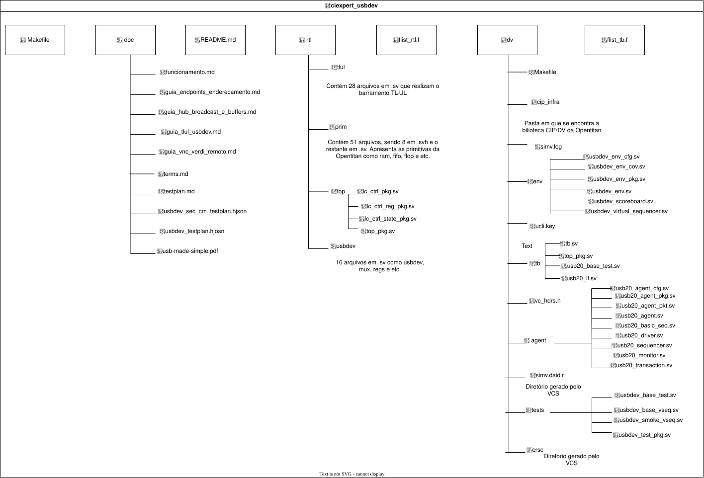

# Verificação do Módulo USB 2.0 (Projeto OpenTitan)

**Desenvolvedores:** Andreza Carneiro, João Navarro e Manoela Terra.

**Especificação Oficial:** [OpenTitan USBDEV](https://opentitan.org/book/hw/ip/usbdev/index.html)

---

## 1. Diagramas de Arquitetura




### Topologia do Ambiente UVM

```text
 usbdev_base_test  (cip_base_test)
 │   +UVM_TEST_SEQ=usbdev_smoke_vseq
 │
 └── usbdev_env  (cip_base_env)
     │
     ├── usbdev_env_cfg ──── RAL (usbdev_reg_block), usb20_agent_cfg
     ├── usbdev_env_cov
     ├── usbdev_virtual_sequencer ─────────────┐ usb20_sequencer_h
     │      ▲  usbdev_smoke_vseq               │
     │      │   └─ usb20_basic_seq ────────────┤
     ├── m_tl_agent (CIP) ───────────┐         │
     ├── alert agents (CIP)          │         │
     ├── usbdev_scoreboard           │         │
     │                               │         │
     └── m_usb20_agent (projeto)     │         │
         ├── usb20_sequencer ◄───────┼─────────┘
         ├── usb20_driver            │
         └── usb20_monitor           │
                │                    │
 ───────────────┼────────────────────┼──────────────────────────  tb.sv
                │ usb20_if           │ tl_if        clk_rst_if (48 MHz)
                │ (D+, D-, sense)    │ (TL-UL)      clk_aon    (~200 kHz)
                ▼                    ▼              intr_if, alert_if
          ┌──────────────────────────────────────┐
          │              usbdev (DUT)            │
          │  usbdev_reg_top · usbdev_usbif ·     │
          │  usb_fs_nb_pe (rx/tx, in/out PE)     │
          └──────────────────────────────────────┘
```

---

## 2. Estrutura do Repositório

### `dv/agent/` (Agente USB 2.0)
*   `usb_transaction`: Item de transação com `pid`, `addr`, `endp` e payload `data[]`. Possui constraints limitando dados de 0 a 64 bytes, endpoints de 0 a 11 e restrição de payload para tokens (IN/OUT/SETUP).
*   `usb20_driver`: Converte o pacote lógico para pinos do DUT (`cio_usb_dp_i/dn_i`). Fluxo: Idle(J) -> SYNC -> PID(8b) -> ADDR/ENDP/CRC5 -> EOP.
*   `usb20_monitor`: Observa o barramento (host -> DUT) e encaminha pacotes via `analysis_port` para o scoreboard.
*   `usb20_sequencer`, `usb20_agent_cfg`, `usb20_agent`: Componentes padronizados herdados da CIP (`dv_base_agent`).
*   `seq_lib/usb20_seq_list`: Lista das sequências do agente, incluída pelo `usb20_agent_pkg`.
*   `seq_lib/usb20_basic_seq`: Sequência base que gera um pacote aleatório.

### `dv/env/` (Ambiente e Checagem)
*   `usbdev_env_cfg`: Configuração geral do ambiente, instanciação do RAL do módulo e restrição de clock fixo em 48 MHz.
*   `usbdev_env`: Estende `cip_base_env`. Instancia o agente USB e realiza as conexões TLM (sequencer ao virtual sequencer e monitor ao scoreboard).
*   `usbdev_scoreboard`: Recebe pacotes do monitor através do método `write_usb20` e realiza a checagem funcional.
*   `usbdev_virtual_sequencer`: Controla as execuções, contendo o handle do sequencer físico (`usb20_sequencer_h`).

### `dv/tests/` (Virtual Sequences e Testes)
*   `usbdev_base_test`: Teste raiz. A Virtual Sequence executada é definida por argumento de compilação (`TEST_SEQ`).
*   `seq_lib/usbdev_base_vseq`: Realiza inicialização (`dut_init`) via TL-UL (RAL): configura `usbctrl.enable=1`, `device_address=0x12` e `ep_out_enable[0]=1`.
*   `seq_lib/usbdev_vseq_list`: Lista das vseqs incluída pelo `usbdev_env_pkg`. Cada colaborador cria sua vseq na própria branch e adiciona uma linha de include no final da lista.

### `dv/tb/` (Testbench Top)
*   `tb.sv`: Instanciação do DUT e conexão das interfaces (clock/reset, barramento TL-UL, alertas, interrupções e `usb20_if`).
*   **Nota:** Os arquivos `top_pkg.sv` e `usb20_base_test.sv` pertencem à estrutura gerada inicialmente e não estão incluídos no `flist_tb.f`.

---

## 3. Makefile - dentro de dv

### Compilação e Simulação Básica
```bash
# 1. Compilar (gera out/simv e banco de cobertura out/simv.vdb)
make compile

# 2. Simular (a cada execução os dados são somados no banco de cobertura)
make sim SEED=1
make sim SEED=2 TEST_SEQ=usbdev_base_vseq
```
*O log de saída será gerado em: `out/sim_<vseq>_<seed>.log`*

### Análise de Cobertura (URG)
Para gerar relatórios agregando os resultados de todas as simulações executadas:
```bash
make cov
```
*   **Modo Gráfico:** Abra `out/urg_report/dashboard.html` no navegador (ex: `firefox out/urg_report/dashboard.html &`).
*   **Modo Texto:** O resumo aparece no terminal e no arquivo `out/urg_report/dashboard.txt`.

*(Comando manual alternativo, caso não utilize o Make: `urg -full64 -dir simv.vdb -report urg_report -format both`)*

### Ferramentas de Debug (Verdi)
```bash
# Abrir cobertura no Verdi
make cov_gui

# Gerar e visualizar formas de onda
make compile WAVE=1
make sim SEED=1      # Gera o arquivo out/sim_waves.fsdb
make wave            # Abre o Verdi com o arquivo gerado
```

**Variáveis do Makefile:** `TEST`, `TEST_SEQ`, `SEED`, `VERBOSITY`, `COV` (padrão = 1), `WAVE`, `GUI`, `PLUSARGS`.

*Nota de limpeza: O comando `make clean` remove todo o diretório `out/`, apagando o histórico de cobertura. Caso precise salvar um relatório definitivo, copie a pasta `out/urg_report/` para `doc/`.*

---

## 4. Desenvolvimento de Testes

**Fluxo de Dados:** Teste -> VSEQ (RAL + Sequences) -> Driver -> DUT -> Monitor -> Scoreboard.

**Como criar um novo cenário de teste:**
1. Crie o arquivo `dv/tests/seq_lib/usbdev_<nome>_vseq.sv` estendendo `usbdev_base_vseq`.
2. Implemente a lógica principal dentro da `task body()`.
3. Inclua o novo arquivo no final da lista de vseqs (`dv/tests/seq_lib/usbdev_vseq_list.sv`).
4. Execute passando o nome da sequência: `make compile && make sim TEST_SEQ=usbdev_<nome>_vseq`.

// open titan roda n testes para coverage conferir para cada teste
## 5. Mapeamento de Hardware e Registradores

### Sinais e Registradores (Geral)
| Categoria | Nome Oficial OpenTitan | Tipo | Descrição |
| --- | --- | --- | --- |
| **Sinais de Interface** | `clk_i` | Signal | Clock principal do sistema |
| | `rst_ni` | Signal | Reset ativo em nível baixo |
| | `clk_aon_i` | Signal | Clock Always-On (utilizado no wake-up) |
| | `rst_aon_ni` | Signal | Reset Always-On |
| **Interface USB** | `cio_usb_dp_i` / `cio_usb_dp_o` | Signal | Linha Data Plus (DP) - Entrada / Saída |
| | `cio_usb_dn_i` / `cio_usb_dn_o` | Signal | Linha Data Minus (DN) - Entrada / Saída |
| | `cio_usb_oe_o` | Signal | Output Enable do transceptor físico |
| | `cio_sense_i` | Signal | VBUS Sense (detecção de cabo conectado) |
| **Registradores de Controle** | `intr_state` | Register | Estado das interrupções do módulo |
| | `intr_enable` | Register | Habilitação das interrupções |
| | `intr_test` | Register | Teste forçado de interrupções |
| | `usbctrl` | Register | Controle principal (`enable`, `pe_en`, `device_address`) |
| | `usbstat` | Register | Status da conexão (`connected`, `link_state`, `frame`) |
| **Endpoints (Smoke Test)** | `ep_out_enable` | Register | Habilita endpoints de saída (OUT) |
| | `ep_in_enable` | Register | Habilita endpoints de entrada (IN) |
| | `rxenable_out` | Register | Habilita recepção nos endpoints OUT |
| **Buffers e FIFOs** | `avoutfifo` | Register | FIFO p/ fornecer buffers disponíveis p/ pacotes OUT |
| | `avsetupfifo` | Register | FIFO p/ fornecer buffers disponíveis p/ pacotes SETUP |
| | `rxfifo` | Register | FIFO de leitura dos pacotes recebidos pelo DUT |

### Estrutura do Registrador `usbctrl`
| Campo | Descrição |
| --- | --- |
| `enable` | Liga/desliga a Posição Física do Módulo (PHY) |
| `pe_en` | Habilita o Protocol Engine (mecanismo digital do USB) |
| `device_address` | Endereço USB atribuído ao periférico (7 bits) |

---

## 6. Teste IN e Análise de Cobertura

### 6.1. Teste `usbdev_in_trans_vseq`

A sequência `usbdev_in_trans_vseq`, localizada em
`dv/tests/seq_lib/usbdev_in_trans_vseq.sv`, integra o ambiente
de verificação USB 2.0 e exercita o cenário de transação IN.

O teste utiliza a infraestrutura UVM do projeto, incluindo
virtual sequencer, agente USB 2.0, driver, monitor e scoreboard.

### 6.2. Execução das simulações

Foram executadas 10 seeds, numeradas de 1 a 10, utilizando
o simulador Synopsys VCS W-2024.09-SP2-3.

Resultado:
- Seeds executadas: 10
- Seeds aprovadas: 10
- Seeds com falha: 0
- Taxa de aprovação: 100%

### 6.3. Metodologia de cobertura

A cobertura foi inicialmente medida com a configuração
original do projeto.

Posteriormente, foram aplicados os arquivos de exclusão
`.el` provenientes da OpenTitan.

Por fim, o teste foi recompilado e executado utilizando
a configuração de cobertura baseada no fluxo `vcs_cov`
da OpenTitan, incluindo opções de instrumentação,
configuração de hierarquia e arquivos de exclusão.

Os arquivos de referência foram obtidos da OpenTitan,
commit `5b83d34b99`.

Para reproduzir a execução, a partir de `dv/`:

```bash
cov_ot/run_cov_ot.sh usbdev_in_trans_vseq 10
```

O relatório é gerado em:

`dv/out_cov_ot/urg_report/dashboard.txt`

### 6.4. Resultados de cobertura

| Métrica | Original | Exclusões .el | Configuração OpenTitan |
|---|---:|---:|---:|
| SCORE | 53,46% | 55,45% | 66,92% |
| LINE | 72,67% | 72,71% | 82,12% |
| COND | 54,27% | 54,62% | 63,47% |
| TOGGLE | 50,27% | 50,27% | 82,62% |
| FSM | 35,16% | 37,21% | 49,15% |
| BRANCH | 67,37% | 67,95% | 77,03% |
| ASSERT | 82,05% | 82,05% | 90,70% |
| GROUP | 12,41% | 23,37% | 23,37% |

A cobertura global passou de 53,46% para 66,92%,
representando um aumento de 13,46 pontos percentuais.

As diferenças entre as medições não decorrem apenas
das exclusões: a configuração OpenTitan também altera
opções de instrumentação e seleção da hierarquia.

### 6.5. Comparação com a OpenTitan

O valor de referência anteriormente levantado para
a cobertura da OpenTitan foi de 62,85%.

A cobertura de 66,92% obtida neste projeto ficou
numericamente 4,07 pontos percentuais acima dessa
referência.

Entretanto, os resultados não demonstram superioridade
do teste desenvolvido, pois não foi comprovada
equivalência completa entre os ambientes, conjuntos
de testes e critérios de cálculo.

### 6.6. Limitações identificadas

Durante a geração do relatório, o URG apresentou avisos
de incompatibilidade nos arquivos de exclusão:

- 9 avisos de instâncias desconhecidas;
- 27 avisos de identificadores de condições inválidos;
- 1 aviso de identificador de branch inválido;
- 3 avisos de incompatibilidade de checksum.

Esses avisos indicam que determinadas exclusões
não puderam ser aplicadas.

O ambiente também possui covergroups de cobertura
funcional definidos em `dv/env/usbdev_env_cov.sv`,
com chamadas de amostragem no scoreboard.

A métrica GROUP atingiu 23,37%, mas sua comparação
com resultados externos exige verificar a equivalência
dos modelos de cobertura funcional.

### 6.7. Conclusão

A sequência `usbdev_in_trans_vseq` foi executada com
sucesso nas 10 seeds avaliadas, sem falhas registradas.

A configuração de cobertura baseada na OpenTitan
produziu SCORE global de 66,92%, fornecendo uma
referência quantitativa para a avaliação do teste.

A comparação com os 62,85% atribuídos à OpenTitan
é indicativa e deve ser interpretada considerando
as diferenças metodológicas e as incompatibilidades
identificadas nos arquivos de exclusão.
