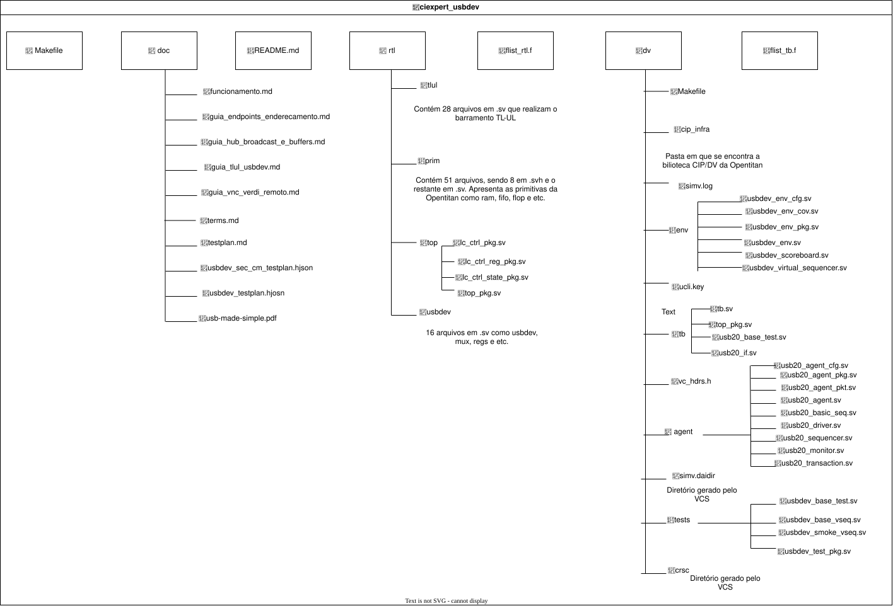
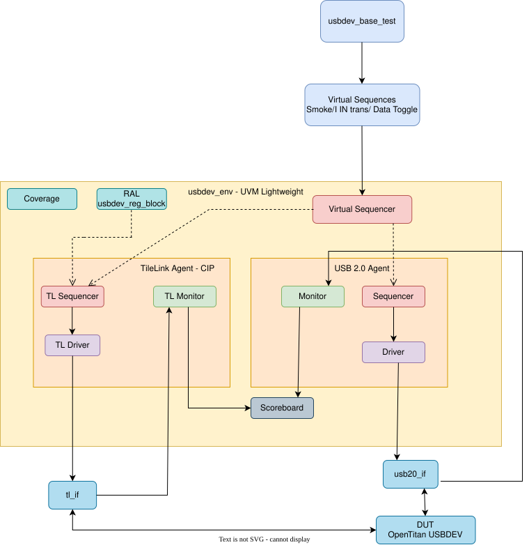

# USB 2.0 Module Verification (OpenTitan Project)

**Developers:** Andreza Carneiro, João Navarro, and Manoela Terra.

**Official Specification:** [OpenTitan USBDEV](https://opentitan.org/book/hw/ip/usbdev/index.html)

---

## 1. Architecture Diagrams




### UVM Environment Topology

```text
  usbdev_base_test  (cip_base_test)
  │   +UVM_TEST_SEQ=usbdev_smoke_vseq
  │
  └── usbdev_env  (cip_base_env)
      │
      ├── usbdev_env_cfg ──── RAL (usbdev_reg_block), usb20_agent_cfg
      ├── usbdev_env_cov
      ├── usbdev_virtual_sequencer ─────────────┐ usb20_sequencer_h
      │      ▲  usbdev_smoke_vseq               │
      │      │   └─ usb20_basic_seq ────────────┤
      ├── m_tl_agent (CIP) ───────────┐         │
      ├── alert agents (CIP)          │         │
      ├── usbdev_scoreboard           │         │
      │                               │         │
      └── m_usb20_agent (project)     │         │
          ├── usb20_sequencer ◄───────┼─────────┘
          ├── usb20_driver            │
          └── usb20_monitor           │
                 │                    │
  ───────────────┼────────────────────┼──────────────────────────  tb.sv
                 │ usb20_if           │ tl_if        clk_rst_if (48 MHz)
                 │ (D+, D-, sense)    │ (TL-UL)      clk_aon    (~200 kHz)
                 ▼                    ▼              intr_if, alert_if
           ┌──────────────────────────────────────┐
           │              usbdev (DUT)            │
           │  usbdev_reg_top · usbdev_usbif ·     │
           │  usb_fs_nb_pe (rx/tx, in/out PE)     │
           └──────────────────────────────────────┘
```

---

## 2. Repository Structure

### `dv/agent/` (USB 2.0 Agent)
* `usb_transaction`: Transaction item with `pid`, `addr`, `endp`, and `data[]` payload. Constraints limit data to 0–64 bytes, endpoints to 0–11, and token payloads (IN/OUT/SETUP).
* `usb20_driver`: Converts logical packets into DUT pin signals (`cio_usb_dp_i/dn_i`). Flow: Idle(J) -> SYNC -> PID(8b) -> ADDR/ENDP/CRC5 -> EOP.
* `usb20_monitor`: Observes the bus (host -> DUT) and forwards packets through an `analysis_port` to the scoreboard.
* `usb20_sequencer`, `usb20_agent_cfg`, `usb20_agent`: Standard components inherited from CIP (`dv_base_agent`).
* `seq_lib/usb20_seq_list`: Agent sequence list included by `usb20_agent_pkg`.
* `seq_lib/usb20_basic_seq`: Base sequence that generates a random packet.

### `dv/env/` (Environment and Checking)
* `usbdev_env_cfg`: General environment configuration, module RAL instantiation, and fixed 48 MHz clock constraint.
* `usbdev_env`: Extends `cip_base_env`. Instantiates the USB agent and establishes TLM connections (sequencer to virtual sequencer, monitor to scoreboard).
* `usbdev_scoreboard`: Receives monitor packets through `write_usb20` and performs functional checking.
* `usbdev_virtual_sequencer`: Controls execution and holds the physical sequencer handle (`usb20_sequencer_h`).

### `dv/tests/` (Virtual Sequences and Tests)
* `usbdev_base_test`: Root test. The virtual sequence to run is selected through the `TEST_SEQ` argument.
* `seq_lib/usbdev_base_vseq`: Performs initialization (`dut_init`) via TL-UL (RAL): sets `usbctrl.enable=1`, `device_address=0x12`, and `ep_out_enable[0]=1`.
* `seq_lib/usbdev_vseq_list`: List of virtual sequences included by `usbdev_env_pkg`. Each contributor creates a virtual sequence in their own branch and adds an include line at the end of the list.

### `dv/tb/` (Testbench Top)
* `tb.sv`: DUT instantiation and interface connections (clock/reset, TL-UL bus, alerts, interrupts, and `usb20_if`).
* **Note:** `top_pkg.sv` and `usb20_base_test.sv` belong to the initially generated structure and are not included in `flist_tb.f`.

---

## 3. Makefile — Run from `dv/`

### Basic Compilation and Simulation
```bash
# 1. Compile (generates out/simv and the out/simv.vdb coverage database)
make compile

# 2. Simulate (each run contributes data to the coverage database)
make sim SEED=1
make sim SEED=2 TEST_SEQ=usbdev_base_vseq
```

*The output log is generated at `out/sim_<vseq>_<seed>.log`.*

### Coverage Analysis (URG)
To generate reports aggregating results from all completed simulations:
```bash
make cov
```

* **Graphical Mode:** Open `out/urg_report/dashboard.html` in a browser (e.g., `firefox out/urg_report/dashboard.html &`).
* **Text Mode:** The summary appears in the terminal and in `out/urg_report/dashboard.txt`.

*(Alternative manual command when not using Make: `urg -full64 -dir simv.vdb -report urg_report -format both`.)*

### Debugging Tools (Verdi)
```bash
# Open coverage in Verdi
make cov_gui

# Generate and view waveforms
make compile WAVE=1
make sim SEED=1      # Generates out/sim_waves.fsdb
make wave            # Opens Verdi with the generated file
```

**Makefile Variables:** `TEST`, `TEST_SEQ`, `SEED`, `VERBOSITY`, `COV` (default = 1), `WAVE`, `GUI`, `PLUSARGS`.

*Cleanup note: `make clean` removes the entire `out/` directory, deleting the coverage history. To preserve a final report, copy `out/urg_report/` to `doc/`.*

---

## 4. Test Development

**Data Flow:** Test -> VSEQ (RAL + Sequences) -> Driver -> DUT -> Monitor -> Scoreboard.

**How to create a new test scenario:**
1. Create `dv/tests/seq_lib/usbdev_<name>_vseq.sv`, extending `usbdev_base_vseq`.
2. Implement the main logic inside `task body()`.
3. Include the new file at the end of the virtual sequence list (`dv/tests/seq_lib/usbdev_vseq_list.sv`).
4. Run the sequence by name: `make compile && make sim TEST_SEQ=usbdev_<name>_vseq`.

<!-- OpenTitan runs multiple tests for coverage; check coverage for each test. -->
## 5. Hardware and Register Mapping

### Signals and Registers (Overview)
| Category | Official OpenTitan Name | Type | Description |
| --- | --- | --- | --- |
| **Interface Signals** | `clk_i` | Signal | Main system clock |
| | `rst_ni` | Signal | Active-low reset |
| | `clk_aon_i` | Signal | Always-On clock (used for wake-up) |
| | `rst_aon_ni` | Signal | Always-On reset |
| **USB Interface** | `cio_usb_dp_i` / `cio_usb_dp_o` | Signal | Data Plus (DP) line — input/output |
| | `cio_usb_dn_i` / `cio_usb_dn_o` | Signal | Data Minus (DN) line — input/output |
| | `cio_usb_oe_o` | Signal | Physical transceiver output enable |
| | `cio_sense_i` | Signal | VBUS sense (connected-cable detection) |
| **Control Registers** | `intr_state` | Register | Module interrupt state |
| | `intr_enable` | Register | Interrupt enable |
| | `intr_test` | Register | Forced interrupt test |
| | `usbctrl` | Register | Main control (`enable`, `pe_en`, `device_address`) |
| | `usbstat` | Register | Connection status (`connected`, `link_state`, `frame`) |
| **Endpoints (Smoke Test)** | `ep_out_enable` | Register | Enables OUT endpoints |
| | `ep_in_enable` | Register | Enables IN endpoints |
| | `rxenable_out` | Register | Enables reception on OUT endpoints |
| **Buffers and FIFOs** | `avoutfifo` | Register | FIFO supplying available buffers for OUT packets |
| | `avsetupfifo` | Register | FIFO supplying available buffers for SETUP packets |
| | `rxfifo` | Register | FIFO for reading packets received by the DUT |

### `usbctrl` Register Structure
| Field | Description |
| --- | --- |
| `enable` | Enables/disables the module's physical interface (PHY) |
| `pe_en` | Enables the Protocol Engine (USB digital logic) |
| `device_address` | USB address assigned to the peripheral (7 bits) |

---

## 6. IN Transaction Test and Coverage Analysis

### 6.1. `usbdev_in_trans_vseq` Test

The `usbdev_in_trans_vseq` sequence, located at
`dv/tests/seq_lib/usbdev_in_trans_vseq.sv`, is part of the
USB 2.0 verification environment and exercises an IN transaction scenario.

The test uses the project's UVM infrastructure, including
the virtual sequencer, USB 2.0 agent, driver, monitor, and scoreboard.

### 6.2. Simulation Runs

Ten seeds, numbered 1 through 10, were executed using
the Synopsys VCS W-2024.09-SP2-3 simulator.

Results:
- Seeds executed: 10
- Seeds passed: 10
- Seeds failed: 0
- Pass rate: 100%

### 6.3. Coverage Methodology

Coverage was initially measured using the project's
original configuration.

Next, the `.el` exclusion files from OpenTitan were applied.

Finally, the test was recompiled and executed using
a coverage configuration based on OpenTitan's `vcs_cov` flow,
including instrumentation options, hierarchy configuration,
and exclusion files.

The reference files were obtained from OpenTitan,
commit `5b83d34b99`.

To reproduce the run, from `dv/`:

```bash
cov_ot/run_cov_ot.sh usbdev_in_trans_vseq 10
```

The report is generated at:

`dv/out_cov_ot/urg_report/dashboard.txt`

### 6.4. Coverage Results

| Metric | Original | `.el` Exclusions | OpenTitan Configuration |
|---|---:|---:|---:|
| SCORE | 53.46% | 55.45% | 66.92% |
| LINE | 72.67% | 72.71% | 82.12% |
| COND | 54.27% | 54.62% | 63.47% |
| TOGGLE | 50.27% | 50.27% | 82.62% |
| FSM | 35.16% | 37.21% | 49.15% |
| BRANCH | 67.37% | 67.95% | 77.03% |
| ASSERT | 82.05% | 82.05% | 90.70% |
| GROUP | 12.41% | 23.37% | 23.37% |

Overall coverage increased from 53.46% to 66.92%,
an improvement of 13.46 percentage points.

The differences between measurements are not solely due
to exclusions: the OpenTitan configuration also changes
instrumentation options and hierarchy selection.

### 6.5. Comparison with OpenTitan

The previously identified OpenTitan coverage reference
was 62.85%.

The 66.92% coverage obtained in this project was
numerically 4.07 percentage points above that reference.

However, these results do not demonstrate that the
developed test is superior, because full equivalence
between the environments, test suites, and calculation
criteria has not been established.

### 6.6. Identified Limitations

During report generation, URG issued warnings about
incompatibilities in the exclusion files:

- 9 unknown-instance warnings;
- 27 invalid condition-identifier warnings;
- 1 invalid branch-identifier warning;
- 3 checksum-mismatch warnings.

These warnings indicate that some exclusions
could not be applied.

The environment also contains functional coverage
covergroups defined in `dv/env/usbdev_env_cov.sv`,
with sampling calls in the scoreboard.

The GROUP metric reached 23.37%, but comparing it
with external results requires verifying the equivalence
of the functional coverage models.

### 6.7. Conclusion

The `usbdev_in_trans_vseq` sequence ran successfully
with all 10 evaluated seeds, with no recorded failures.

The OpenTitan-based coverage configuration produced
an overall SCORE of 66.92%, providing a quantitative
reference for test evaluation.

The comparison with the 62.85% attributed to OpenTitan
is indicative and should be interpreted in light of
methodological differences and the identified
incompatibilities in the exclusion files.
